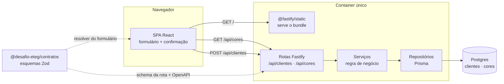
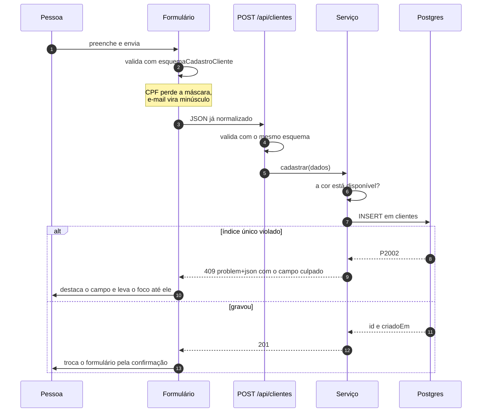

# Arquitetura

Uma tela, uma API, um banco. O que segue é onde cada coisa mora e por onde
passa um cadastro. As decisões e o que se paga por elas estão em
[docs/adr](adr/README.md).

## Visão geral



O container é um só, e é isso que faz front e API compartilharem a origem: sem
CORS no caminho e com o CSP do helmet fechado em `'self'`. Ver
[ADR 0006](adr/0006-imagem-unica.md).

A caixa pontilhada é o ponto que sustenta o resto: o mesmo esquema Zod valida
o formulário, valida o corpo da requisição e gera a documentação. Não há como
as pontas divergirem sem quebrar o build ([ADR 0003](adr/0003-contratos-compartilhados.md)).

## Camadas da API

```
rotas/          HTTP: schema, status, cabeçalho. Não conhece Prisma.
servicos/       Regra de negócio. Lança erro de domínio, não status code.
repositorios/   Acesso ao banco. Traduz erro do Prisma em erro de domínio.
plugins/        Recortes transversais: banco, erros, segurança, observabilidade,
                documentação e arquivos estáticos.
infra/          Conexão e monitoramento.
config/         Ambiente, validado uma vez no boot.
```

As dependências são montadas num lugar só, em `servidor.ts`, e entregues
prontas a quem precisa delas. Nenhuma camada instancia a de baixo por conta
própria, o
que deixa qualquer uma substituível em teste, e é o que permite os testes de
integração apontarem para um Postgres descartável sem tocar no código de
produção.

`criarServidor` não escuta porta nenhuma. Quem decide é quem chama: `main.ts`
coloca para escutar, os testes usam `app.inject()`.

## O cadastro, do clique ao 201



Três detalhes que não são acidentais:

**A validação acontece duas vezes de propósito.** A do formulário existe para
a pessoa saber do erro antes de enviar; a da rota existe porque validação de
cliente não é validação. São o mesmo código, então não custam manutenção
dobrada.

**O `409` nasce da tentativa de gravar**, e não de uma consulta prévia.
Consultar antes deixaria uma janela entre a checagem e o `INSERT` em que dois
envios simultâneos passariam os dois ([ADR 0004](adr/0004-unicidade-no-banco.md)).

**A confirmação substitui o formulário.** É o que atende ao "ao clicar em
enviar, o mesmo deve saber se o cadastro foi bem sucedido" sem deixar na tela
um formulário preenchido convidando a um segundo envio.

## Erros

Um tratador só, em `plugins/erros.ts`, converte exceção em resposta
[RFC 9457](https://www.rfc-editor.org/rfc/rfc9457). As camadas de baixo lançam
erro de domínio sem conhecer status code, e nenhuma rota inventa um formato
próprio. O catálogo está em [erros.md](erros.md).

## Onde o dado pessoal não vai

Nome, CPF, e-mail e observações são redigidos no logger da API e não têm como
entrar no relatório de erro do front. O detalhe e o motivo estão na
[ADR 0007](adr/0007-pii-e-logs.md).

## O que ficou de fora, e por quê

**Autenticação.** O formulário é público por definição do caso de uso: são os
clientes do John Doe se cadastrando, não usuários de um sistema.

**Edição e exclusão de cadastro.** O enunciado pede cadastro único. Um `PATCH`
sem ninguém para autorizá-lo seria pior que não existir.

**Fila ou mensageria.** Um `INSERT` por cadastro não justifica um broker.

**Multi-tenancy.** Não há segundo cliente no enunciado.

Cada um desses entra no dia em que houver requisito. Antes disso é código para
manter sem ninguém para servir.
